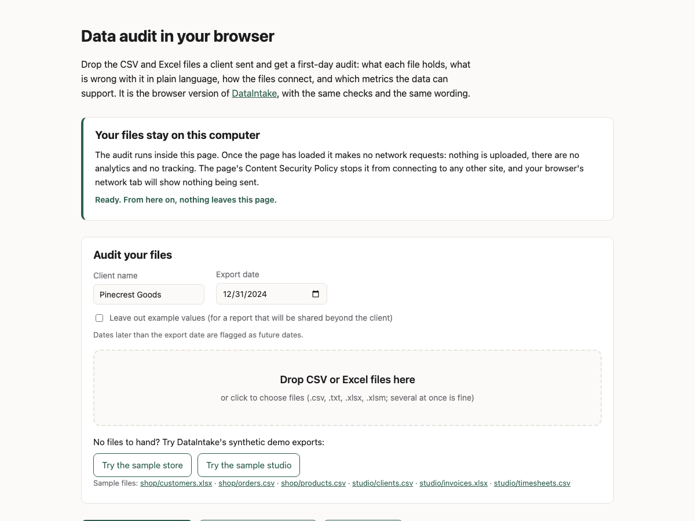

# intake-web

DataIntake's first-day data audit as a static web page: drop CSV and Excel exports, get the
report, with every file read and checked in your browser. TypeScript, Vite, DuckDB-Wasm,
SheetJS, Web Workers.

**Try it: [m4dd0ck.github.io/intake-web](https://m4dd0ck.github.io/intake-web/)**
(the sample buttons load DataIntake's synthetic demo exports)



This file is the reference: what exists and how it works. `RUNBOOK.md` is the procedures,
`CLAUDE.md` the agent rules, `TASK.md` the open items.

## What it is

A browser version of [DataIntake](https://github.com/m4dd0ck/data-intake). A visitor drops the
files a client sent (or tries the bundled sample exports) and gets the same report the Python
tool writes: what each file holds, what is wrong with it in plain language, how the files
connect, and which metrics the data can support. The report shows on the page and downloads
as one self-contained HTML file; the findings download as JSON in the same shape as
`intake audit --json`.

Files never leave the machine. After the page and its audit engine have loaded it makes no
network requests: no uploads, no analytics, no fonts or scripts from anywhere else.

## Why it exists

DataIntake needs Python and uv, which is a lot to ask of a prospective client who only wants to
see what the audit says about their own exports. Nor should they have to trust a server with
their customer list. This page needs neither an install nor that trust: it is static files, and
the browser refuses to send data anywhere.

## Quick start

Needs Node 24 or later.

```bash
npm ci
npm run dev          # open the printed URL, click "Try the sample store"
```

`npm run build` writes the static site to `dist/`; `npm run preview` serves it, with the
Content Security Policy that the dev server leaves out.

## Commands

All run as `npm run <script>`. The table is regenerated from `package.json` by the doc check.

<!-- generated:commands start -->
<!-- do not hand-edit: regenerated by doc-check --fix -->
| Command | What it does |
|---|---|
| `npm run dev` | vite |
| `npm run build` | tsc --noEmit && vite build |
| `npm run preview` | vite preview |
| `npm run typecheck` | tsc --noEmit |
| `npm run lint` | eslint . && prettier --check . |
| `npm run format` | prettier --write . |
| `npm run test` | vitest run |
| `npm run test:e2e` | playwright test |
| `npm run test:live` | LIVE_URL=https://m4dd0ck.github.io/intake-web/ playwright test |
<!-- generated:commands end -->

`scripts/refresh-fixtures.sh <data-intake checkout>` rebuilds `sample/` and `tests/fixtures/`
from DataIntake; `RUNBOOK.md` says when.

## How it works

### Pipeline

```
files (drop, picker or bundled sample)
  -> audit worker (module Web Worker; the page's main thread only draws)
       CSV  -> DuckDB-Wasm read_csv(all_varchar, header = false, sample_size = -1) -> text rows
       xlsx -> SheetJS (dense, nodim, raw numbers + number formats) -> text rows per sheet
       text rows -> header detection -> five checks, joins, metric rules, profiles
  -> page: report rendered from escaped HTML; HTML and JSON downloads as Blob URLs
```

The checks are the same as DataIntake's (structure, missing data, formats, duplicates,
outliers, relations, metrics), with the same codes, severities, thresholds and wording. They are
plain TypeScript over text cells (`src/audit/`), so they run unchanged in the browser and under
Node in the tests.

### How it stays honest

- **Parity is tested, not claimed.** `tests/fixtures/` holds DataIntake's `--json` output for
  the files in `sample/`. The parity test fails on any difference in findings, wording,
  examples, row counts, column profiles, joins or metrics, and the JSON this page writes must
  equal the Python file byte for byte.
- **Same reader for CSV.** DuckDB-Wasm runs the exact `read_csv` call DataIntake runs, so both
  tools see the same rows; the tests use DuckDB-Wasm's Node build rather than a stand-in.
- **Python's text rules are reproduced.** `src/audit/py.ts` and `src/audit/fuzz.ts` copy what
  shows up in report text: `str.strip`, `repr`, half-to-even rounding, `statistics.quantiles`,
  rapidfuzz scores.
- **No requests after load.** The worker starts DuckDB as the page loads; the samples are
  bundled into the page as base64. A Content Security Policy (`connect-src 'self'`, no inline
  scripts) is injected into the built page, and the Playwright test fails on any request after
  the engine is ready, any request to another origin, or any policy violation.
- **Safe to send.** The downloaded report has inline styles, no scripts and no external assets,
  and every value from the data is escaped, as in DataIntake.

### Limits

- CSV, `.txt`, `.xlsx` and `.xlsm`, as in DataIntake. Files over 200 MB, a million rows or 500
  columns are refused.
- The engine is a one-off download of 36 MB, which GitHub Pages serves gzipped as 8.3 MB
  (measured 2026-11-01), fetched when the page opens.
- Needs a browser with WebAssembly exception handling and workers inside workers: current
  Chrome, Edge, Firefox and Safari.
- Everything is held in the tab's memory; a file of a few hundred MB may be too much for a
  phone.

## Layout

```
index.html              # the page
src/
├── audit/              # the port: kinds, checks/, relations, kpis, audit, Python text rules
├── load/               # CSV through DuckDB, Excel through SheetJS, file routing and limits
├── report/             # HTML (page and download) and JSON, shared stylesheet
├── worker/             # the audit worker and the DuckDB engine it starts
└── ui/                 # page script, styles, bundled samples, downloads
sample/                 # DataIntake's synthetic demo exports (committed)
tests/                  # vitest: each check, loaders, report, parity; fixtures/ from DataIntake
e2e/                    # Playwright smoke test against the built site
scripts/                # fixture refresh from a DataIntake checkout
assets/                 # README screenshot, taken from the live site
PRPs/, INITIAL.md       # the plan this was built from
```

Generated and gitignored: `dist/`, `node_modules/`, `test-results/`, `playwright-report/`.

## Outside the repo

| Thing | Where | Notes |
|---|---|---|
| DataIntake | https://github.com/m4dd0ck/data-intake | source of the checks, the samples and the fixtures |
| Site | GitHub Pages for this repo | `.github/workflows/pages.yml` tests, builds and deploys `dist/` on every push to `main` |

## Vocabulary

- **Finding**: one problem with a code, severity (critical, warning, info), table, column,
  detail, impact line and examples.
- **Export date (as of)**: the date the data was exported; later dates are flagged.
- **Parity**: this page and `intake audit` producing the same audit from the same files.

## Decisions

- 2026-11-01 Checks run in TypeScript over text, not in SQL: DuckDB-Wasm parses CSV only. Excel
  sheets never pass through DuckDB, and DataIntake also checks text in Python after DuckDB
  reads it, so one TypeScript path keeps parity simple.
- 2026-11-01 Only DuckDB-Wasm's `eh` bundle ships: each bundle is about 36 MB and every current
  browser supports wasm exceptions.
- 2026-11-01 DuckDB-Wasm is pinned to `1.33.1-dev57.0`, the npm `latest` tag (DuckDB 1.5.4;
  DataIntake runs 1.5.6). The last release without `dev` in its name is from 2025-12.
- 2026-11-01 SheetJS 0.20.3 is installed from the SheetJS CDN tarball, because the npm `xlsx`
  package stopped at 0.18.5; the lockfile pins its integrity hash.
- 2026-11-01 TypeScript is pinned to 6.0: typescript-eslint does not support 7 yet.
- 2026-11-01 DuckDB runs as `AsyncDuckDB` in its own worker, started from the audit worker. It is
  the documented browser API; the package does not export its blocking browser build.
- 2026-11-01 The engine loads at page start and the samples are bundled, so the page truly makes
  no request after load; the cost is the engine download for visitors who never drop a file.
- 2026-11-01 The CSP is a meta tag added only in the build: GitHub Pages cannot send headers, and
  the dev server needs inline scripts.
- 2026-11-01 Light and dark follow the system setting, as DataIntake's report does; no toggle.
- 2026-11-01 Deliberate differences from DataIntake:
  - Excel goes through SheetJS, not openpyxl. Cells become the same text (ISO dates, whole
    numbers without `.0`, `True`/`False`), but duration formats such as `[h]:mm` print as clock
    times rather than Python timedeltas, and integers beyond 2^53 lose precision.
  - Visitors pick files, not a folder: there are no symlinks to skip, and unsupported files are
    listed in a notice instead of being ignored silently.
  - JavaScript's `\d`, `\b` and `toLowerCase` are ASCII-based or differ slightly from Python's
    Unicode rules, so exotic digits or letters can classify differently.
  - The downloaded report's footer names this page and lists the files read.
  - On the bundled samples there is no difference at all; the parity test checks it.

## History

- 2026-11-01 First version: the full DataIntake audit in the browser, parity with DataIntake on
  both demo businesses, Playwright smoke test, Pages workflow.

## Development

```bash
npm run lint && npm run typecheck
npm test
npm run test:e2e        # first time: npx playwright install chromium
```

CI runs the same checks and deploys the built site to Pages from `main`. Licensed MIT
(`LICENSE`); the sample exports are DataIntake's synthetic demo data, also MIT.

## Pointers

- `RUNBOOK.md`: run, refresh the fixtures, deploy, restore.
- `CLAUDE.md`: the agent rules.
- `TASK.md`: what is open.
